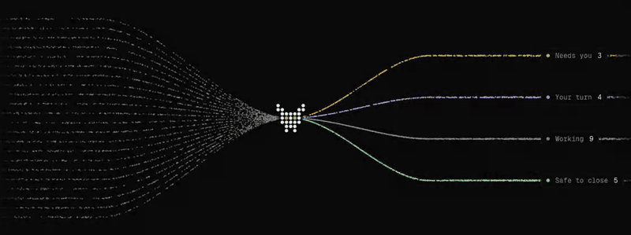
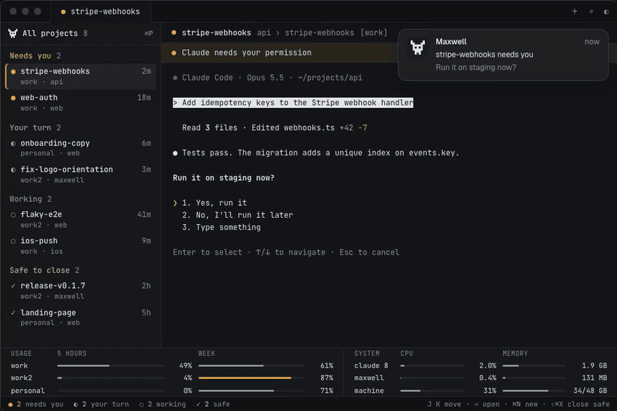

<p align="center">
  
</p>

<h1 align="center">Maxwell</h1>

<p align="center">
  <b>The session manager for Claude Code.</b><br>
  See every Claude Code session across your projects and accounts: which ones need you, which are still working, and which you can close.
</p>

<p align="center">
  
  
  
  
</p>

<p align="center">
  <a href="#install">Install</a> ·
  <a href="#what-you-see">What you see</a> ·
  <a href="#safe-to-close-means-safe">Safe to close</a> ·
  <a href="#keys">Keys</a> ·
  <a href="#configure">Configure</a>
</p>

<p align="center">
  
</p>

---

## Why

Running ten or twenty Claude Code sessions across projects and accounts turns your head into the scheduler. Which session was working on which feature? Who is waiting for an answer? Which account still has usage left? Can I close this one, or is it still doing something?

Maxwell keeps track so you don't have to. It reads what every session is doing, groups them by what they need from you, and only calls a session safe to close when it can prove it.

The name comes from Maxwell's demon, the thought-experiment creature that sits at a gate and sorts what passes through.

<p align="center">
  
</p>

## What you see

| Group | Meaning |
|---|---|
| **Needs you** | A permission prompt or question is open, or the turn ended on something only you can give: its status line says Needs you, or Claude Code marks it blocked. You get a notification. |
| **Your turn** | The turn is over and nothing runs. Read it, reply or close it. |
| **Working** | A turn or subagent is running, or the reply is in and background work it started is still running. Leave it alone. |
| **Limited** | It hit a usage limit. Resume when the window resets, or move it to the account with the most room. |
| **Safe to close** | Every check passed. Expand the row to see each one. |
| **Idle** | Stopped and quiet for a day. Folded away. |

Maxwell takes each group from Claude Code's own record first: what the process says it is doing (`sessions/<pid>.json`), and for background sessions its verdict on the last turn (`jobs/<id>/state.json`). Then it reads the session's status line, and only then the wording of the reply. Hooks make the change show at once, and the next listing confirms or corrects it within seconds. Hover the line under a session's title to see where its group came from. `Maxwell state` prints the same thing for every session.

- **Projects stay separate.** A rail on the left, like the macOS Dock, switches between projects. Pin the ones you work on, and the others only appear when something there needs you. Each project shows its own logo, redrawn in Maxwell's style.
- **The real session, in place.** The middle pane is the actual Claude session, attached in a Ghostty terminal. Closing Maxwell doesn't stop it.
- **Files open beside the session, in tabs.** When a session writes or mentions a Markdown file, it opens on the right, rendered, in a preview tab that its next file replaces, like VS Code's. ⌘-click any path in the terminal to give it a tab of its own; double-click a tab to keep it. Each tab keeps your place, a dot marks a tab with something new, ⌥⌘← → step through them, and they come back after a restart.
- **Artifacts too, in the right account.** When a session publishes a claude.ai artifact, it opens on the right, signed in to that session's account; a republish reloads it in place. Each account signs in once, on claude.ai's own page, and keeps its own login. Click an artifact link in the terminal to open it the same way, or ⇧⌘O for the account's browser profile or container.
- **Usage for every account.** 5-hour and weekly use with reset times, next to CPU and memory for your Claude processes.
- **Panels go where you want them.** Sessions, viewer, usage and system can sit left, right or bottom, collapse to a stripe, and remember their place on each screen, like tool windows in JetBrains IDEs.
- **Names you can read at a glance.** A session keeps Claude's title when it says something. When it's only a slug ("acme-75"), generic ("Continue Previous Task") or the first words of the prompt ("hi, do I need to do"), Haiku names the task once, for about $0.0003. Right-click a session to rename it yourself. Your name always wins. `Maxwell titles` lists every title and where it came from.
- **Right-click a session** to open, rename, move it to another project, bring it in from a terminal, or close it.
- **Plugins.** Linear and Slack ship with Maxwell. Linear shows each session's ticket and status on its row and adds "ticket done" to Safe to close. Slack lists who is waiting on a reply from you; Start Session links a session to the message, and it isn't safe to close until you've replied. Anyone can write a plugin in any language ([`docs/plugins.md`](docs/plugins.md)).
- **Search everything.** ⌘P, or Shift twice, finds a session by title, project, branch, account, last message or a file it touched.

## Safe to close means safe

Closing a session that's still working, or that's waiting on you, costs you work. So Maxwell is strict:

1. **Unknown is never safe.** If Maxwell can't check something, the session isn't safe.
2. **It needs proof of a finished task.** Nothing is running, including background tasks and subagents. Its last message asks nothing and offers nothing. Git is clean and pushed, and the PR is merged if there is one.
3. **The session says where it stands.** Every session is told to end each reply with one status line: **Safe to close**, **Not done** or **Needs you**, and a few words. Maxwell shows it on the session, and "Not done" or "Needs you" keeps it from being safe. `wrap-line = off` stops asking for it.
4. **A final read by a small model, when the session didn't say.** A reply that ends in **Safe to close** is taken at its word once every other check passes. Otherwise, only for sessions that passed everything else, Haiku reads the last message once and has to answer `finished`. Each read costs about $0.0002.
5. **You see the evidence.** Each safe session lists every check and where its result came from. "Close all safe" covers the open project, leaves pinned sessions alone, and shows the list first.
6. **Checked again at the moment of closing.** If anything changed, that session is skipped.
7. **Closing never deletes.** Maxwell only runs `claude stop`, which keeps the conversation. Undo for 10 seconds, and reopen anything from Recently closed for 7 days. You can close any session yourself too, from its right-click menu or ⇧⌘⌫. If it isn't safe yet, Maxwell says what's still open and asks first.
8. **"Not safe" teaches it.** Mark a wrong call and it becomes a test case, so the mistake can't repeat.

Run `Maxwell state` to audit every session and see which check holds each one back.

## Keys

| Key | Action |
|---|---|
| ⌘P or ⇧⇧ | Search sessions, projects and actions |
| ⌘K | Actions only |
| J / K, ⏎ | Move through sessions, open one |
| ⌘J | Next session that needs you |
| ⌘0 / ⌘1–9 | All projects / one project |
| ⌘T | New session in the open session's folder or project, on the account with the most room |
| ⌥⌘T | New terminal: a plain shell at the top of the sidebar, in the current session's folder (or right-click a session › Open Terminal Here). Run `claude` in it and the row becomes that session |
| ⌘N | New session: pick the project (search all your repos) and account. From a terminal: `open -a Maxwell .` |
| Esc or click outside | Close search, the palette or a panel |
| ⇧⌘⌫ | Close the session: at once when it's safe, otherwise after saying what's still open |
| ⇧⌘X | Close all safe (asks first) |
| ⌘⌫, ⌥⌫ | In the terminal: delete to the start of the line, delete a word |
| ⌘V | Paste text, copied files (as paths) or a screenshot (as an image) |
| ⌘Z | Undo the last close |
| ⌘B, ⌥⌘B, ⌥⌘J | Toggle left, right, bottom panels |
| ⌥⌘P | Pin the current file or artifact |
| ⌥⌘R, ⇧⌘O | Reload the artifact, open it in the account's browser |
| ⇧⌘I | Show or hide Idle |
| ⇧⌘L | Switch light and dark (View › Appearance: Light, Dark, Follow System) |
| ⇧⌘O | Open the session's Linear ticket |
| ⌘, | Settings: General, Appearance, Accounts, Projects, Plugins, Keys, Advanced (⌘1–7 inside) |

Every key can be changed with a `keybind` line in the config.

## Install

You need a Mac with Apple silicon, macOS 14 or later, and Claude Code.

1. Install with [Homebrew](https://brew.sh):

   ```sh
   brew install --cask robinsadeghpour/maxwell/maxwell
   ```

   Or [download Maxwell](https://github.com/robinsadeghpour/maxwell/releases/latest/download/Maxwell.dmg), open it and drag Maxwell to Applications. Older versions are on [Releases](https://github.com/robinsadeghpour/maxwell/releases). Maxwell is signed and notarized by Apple, so it opens without a warning.
2. Open Maxwell. **Set up Maxwell** lists what's left: Claude Code, the session hooks (how Maxwell learns what your sessions are doing), a claude.ai sign-in for artifacts, and notifications. Each step has one button.

### Updates

Maxwell checks GitHub for a new release every few hours. When one is ready, the bottom bar shows **v0.1.7 ready · Restart to update**. Nothing changes until you click it. Then Maxwell quits, swaps in the new version and opens again. Your Claude sessions keep running the whole time, because they are background sessions. **Maxwell › Check for Updates…** checks right away.

Installed with Homebrew? Maxwell still updates itself. The cask is marked `auto_updates`, so `brew upgrade` leaves it alone, and `brew upgrade --greedy maxwell` updates it through Homebrew if you prefer. Before `brew uninstall`, choose **Maxwell › Uninstall Hooks**.

### Signing in to claude.ai, once per account

Artifacts need a claude.ai login, and each account has its own. Maxwell already knows which account every session runs on, so it always picks the right login. You only sign in once per account.

1. Open **Settings › Accounts** (⌘, then ⌘3). Each account has a **claude.ai** row with the email it uses in Claude Code.
2. Click **Sign in…**. claude.ai's own sign-in page opens. Sign in with that email, using Google or email. Sign in with Apple doesn't work inside Maxwell.
3. The window closes by itself and the row says **Signed in**. Do the same for the other accounts.

Or skip Settings: the first artifact from an account shows **Sign in to claude.ai** in the viewer, and you sign in right there.

- The logins stay separate and survive restarts. **Sign out** removes one.
- If Google refuses the page, use "Continue with email". If the email has a sign-in link, copy it, then click **Paste link** above the page.
- Signed in with the wrong email? The artifact says "This account can't open the artifact". **Sign in again** clears that login so you can use the right one.
- **Open in browser** (⇧⌘O) uses the browser, profile or container set for that account in Settings › Accounts.

## What it touches on your Mac

Everything stays on your machine. Maxwell sends nothing anywhere, apart from the Haiku reads above, which go through your own Claude account, and what plugins you turn on send (the Linear plugin talks to Linear's API with your key, and the Slack plugin reads your DMs, mentions and threads with your token, read only; each only after you add a key).

| What | Where | Undo |
|---|---|---|
| Hook entries for 6 events | each account's `settings.json`, backed up next to it first | `Maxwell uninstall-hooks` restores them exactly |
| One line that samples usage | your status-line script, backed up first | same |
| The hook program (C, ~2 ms, always exits 0) | `~/.local/share/maxwell/` | delete the folder |
| Event log, and the status-line rule the hook gives new sessions | `~/.local/state/maxwell/` | delete the folder |
| Config | `~/.config/maxwell/config` | delete the file |
| claude.ai logins, one per account | Maxwell's own WebKit storage | Settings › Accounts › Sign out |
| Your plugins | `~/.config/maxwell/plugins/` | delete the folder |
| Plugin secrets (Linear API key, Slack token) | Keychain, "Maxwell plugin <id>" | Settings › Plugins › Remove |

## Configure

`~/.config/maxwell/config` reloads the moment you save it. The Settings window writes the same file.

```
theme = graphite              # graphite | silver | paper | your own theme file
font-size = 13                # lists, panels and the viewer
terminal-font-size = 12       # ⌘− and ⌘= change this one
account = work ~/.claude      # <name> <CLAUDE_CONFIG_DIR>, one line per account
project-pin = Acme            # projects kept on the rail, in order
rail = auto                   # auto slides in at the left edge, shown keeps it visible
project-logo-style = engraved # engraved | pixel | monogram
idle-after = 24h              # quiet time before a stopped session folds into Idle
judge = on                    # off skips the model read, so nothing is ever safe
wrap-line = on                # sessions end each reply with a status line Maxwell reads
notify = true
auto-open = true
artifacts = viewer            # viewer (beside the session, signed in) | browser
```

The full list of keys, with defaults, is in [`docs/config.md`](docs/config.md). Themes are small token files in `Resources/themes`. Put your own in `~/.config/maxwell/themes/`.

## How it works

```
Claude Code hooks ─┐
status line tap ───┼─▶ events.jsonl ─▶ reduce(State, Event) ─▶ the window
claude agents ─────┘
```

- **Hooks** append each session event to one log file, from every account, whether Maxwell is open or not.
- **One pure reducer** turns that log into the state of every session. The app folds it at launch and follows it live. Nothing else changes session state.
- **Sessions you start in Maxwell** are Claude Code background sessions (`claude --bg`), so they survive the app closing or crashing. Sessions running in another terminal are shown read-only.
- **The terminal** is [libghostty](https://ghostty.org), pinned to one commit and upgraded on purpose.

Speed and memory are checked on every build by `./measure.sh`: window on screen under 300 ms, under 150 MB idle and at launch peak, and 20 open sessions under 400 MB.

## Develop

[CONTRIBUTING.md](CONTRIBUTING.md) is the short version, [docs/engineering-standard.md](docs/engineering-standard.md) says how the code is organised, and [docs/cleanup-plan.md](docs/cleanup-plan.md) is the work in progress.

You need Xcode 27 with the Metal Toolchain (`xcodebuild -downloadComponent MetalToolchain`) and Zig 0.17 (`brew install zig`). Releases also need a Developer ID Application certificate, an App Store Connect API key in [asc](https://github.com/rorkai/App-Store-Connect-CLI) for notarization, and [uv](https://docs.astral.sh/uv/) for the DMG. The top of `release.sh` lists the one-time setup.

```sh
./build.sh          # builds Maxwell Dev (first run also builds Ghostty, ~3 min)
./build.sh test     # reducer and verdict tests, from recorded real hook payloads
./measure.sh        # performance budgets, fails loudly
```

### Releasing

Releases are built by GitHub Actions on a clean Mac, one at a time. Add the version to the website changelog (`site/src/changelog.mjs`, then `node site/src/build.mjs`), push `v1`, and start the **Release** workflow from the Actions tab or with:

```sh
gh workflow run release.yml -R robinsadeghpour/maxwell -f version=0.1.13 -f notes="What changed"
gh run watch -R robinsadeghpour/maxwell "$(gh run list -R robinsadeghpour/maxwell -w release.yml -L 1 --json databaseId -q '.[0].databaseId')"
```

It runs `release.sh` from `v1`: tests, builds, signs with the Developer ID certificate, has Apple notarize the app and the DMG, pushes `main` and publishes the DMG and zip. A version that's already released is refused, and a second release waits for the first. GhosttyKit is cached, so zig only runs when its pinned commit changes. `dry_run` only tests and builds. The [Homebrew tap](https://github.com/robinsadeghpour/homebrew-maxwell) follows releases on its own within 30 minutes (`packaging/homebrew/bump-cask.sh`). A release made on a Mac bumps it right away.

The certificate and the notary key are secrets of the repo's `release` environment, which only `v1` and `main` can use. `packaging/ci/set-release-secrets.sh` puts them there. `./release.sh 0.1.13 "What changed"` still releases from a Mac set up as the top of `release.sh` describes.

**Maxwell Dev** is a separate app with its own ID, name and a "dev" badge on its Dock icon. It works on your real sessions and config, but quitting, crashing or relaunching it never touches the Maxwell you work in. The released Maxwell changes only when you click **Restart to update**.

`MAXWELL_PLUGINS_DIR` points Maxwell at another plugins folder, `MAXWELL_LINEAR_FIXTURES` and `MAXWELL_SLACK_FIXTURES` make the plugins read recorded fixtures, and `MAXWELL_AGENTS_FIXTURE` replaces `claude agents --json` with a file, for screenshots of demo sessions.

Scripted test runs (anything with `--quit-after`) are quiet: no Dock icon, the window stays behind yours and never takes focus, and keys and clicks are injected inside the app with `--keys "2:shift shift;3:esc"` and `--click "4:700,600"`. Screenshots come from `--snap`.

| Folder | What's in it |
|---|---|
| `Sources/Model` | Data shape, event parsing, reducer, safe-to-close verdict, config. No AppKit. |
| `Sources/App` | App delegate, window, store, probes (agents, git, transcripts), CLI |
| `Sources/UI` | The component set, rail, panels, search, viewer, libghostty embed, themes, motion |
| `Sources/Install` | Hook installer that edits settings without reordering them |
| `Sources/Plugins` | Plugin host: discovery, the JSON-RPC wire, restarts, Keychain secrets |
| `plugins/` | Plugins that ship with Maxwell (Linear, Slack) and the Swift plugin SDK |
| `examples/plugins/` | A complete plugin in 55 lines of Python |
| `hook/` | The hook and status-line tap, in C |
| `scripts/` | `check-standard.py`, the engineering standard's ratchet, and its baseline |
| `docs/` | Config reference and the images in this README |
| `site/` | The website, [runmaxwell.com](https://www.runmaxwell.com). Docs and changelog live in `site/src/`; `node site/src/build.mjs` writes the pages |

Ghostty is pinned to `8046a2360340ec9788e0089da5a9ed0378adf0ea`. To upgrade, change the commit in `build.sh`, rebuild and re-run both commands above.

## Status

Early. v1 covers the core: what needs you, projects, accounts, safe closing. Next, roughly in order:

- A supervisor that handles the obvious "go on" for you, and suggests improvements you accept or reject
- A phone app

## Licence

MIT. Ghostty is MIT, JetBrains Mono is OFL 1.1, marked is MIT, highlight.js is BSD-3-Clause.
